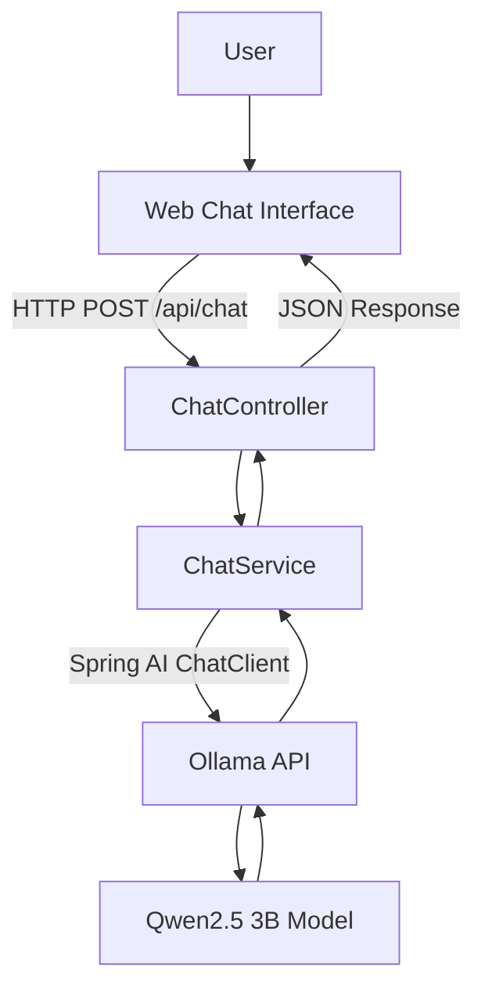

# ✦ Mitra AI — Your Local AI Companion

**A curious mind for your curious mind.**

Mitra AI is a local-first virtual companion built with Java, Spring Boot, Spring AI, and Ollama. It lets you converse with a locally running Large Language Model (LLM) through a simple web-based chat interface — without paid AI APIs, API keys, or cloud AI dependencies.

The project is designed to be both a useful personal experiment and a practical learning journey into building AI-powered applications with the Spring ecosystem.

## 🎯 Project Goals

- Build a conversational AI companion with a curious and intellectual personality.
- Learn Spring AI through a working, end-to-end application.
- Run an LLM locally using Ollama.
- Understand prompts, model configuration, REST APIs, and conversation context.
- Keep the initial implementation simple, local, and free to run.
- Create a foundation for gradually exploring more advanced AI capabilities.

## ✨ Features

- **Natural conversations:** Ask questions, explore ideas, and discuss technology, science, philosophy, history, and everyday topics.
- **Curious personality:** Mitra is designed to be thoughtful, inquisitive, friendly, and intellectually engaging.
- **Local LLM inference:** Generate responses using a model running on your own computer.
- **Simple web interface:** Chat through a lightweight browser-based UI.
- **Conversation context:** Recent messages are sent with each request so Mitra can respond in context.
- **Reset conversation:** Start a fresh conversation whenever you want.
- **No paid AI APIs:** No OpenAI, Gemini, Groq, or AWS Bedrock API is required.
- **Beginner-friendly architecture:** A small Spring Boot application with a clear separation between the web layer and AI service.

## 🛠️ Technology Stack

| Technology | Purpose |
|---|---|
| Java 21 | Programming language |
| Spring Boot 3.5.x | Application framework |
| Spring AI 1.1.x | AI integration and chat abstraction |
| Ollama | Local LLM runtime |
| Qwen2.5 3B | Conversational language model |
| Maven | Dependency management and build |
| HTML, CSS, JavaScript | Web-based chat interface |

> **Note:** The initial implementation targets Spring AI 1.1.x and uses a compatible release configured in `pom.xml`. Keep Spring Boot, Spring AI, and Java versions compatible when upgrading dependencies.

## 🏗️ Architecture



### Request Flow

1. The user enters a message in the browser.
2. The frontend sends the message and recent conversation history to the Spring Boot backend.
3. `ChatController` receives the request.
4. `ChatService` prepares the system prompt and conversation context.
5. Spring AI's `ChatClient` communicates with Ollama.
6. Ollama runs the model locally and generates a response.
7. The backend returns the response as JSON.
8. The browser displays Mitra's reply and retains recent messages in browser memory.

## 📁 Project Structure

```text
mitra-ai/
├── pom.xml
├── mvnw
├── mvnw.cmd
└── src/
    └── main/
        ├── java/
        │   └── com/
        │       └── mitra/
        │           └── ai/
        │               ├── MitraAiApplication.java
        │               ├── ChatController.java
        │               ├── ChatService.java
        │               ├── ChatRequest.java
        │               ├── ChatResponse.java
        │               └── ChatTurn.java
        └── resources/
            ├── application.properties
            └── static/
                └── index.html
```

## 💻 Prerequisites

Before running Mitra AI, make sure you have:

- Java 21 JDK
- Ollama installed
- Maven or the included Maven Wrapper
- An internet connection for the initial dependency and model downloads
- Sufficient RAM and disk space for the selected model

The initial development environment targets Windows 11 with 16 GB system RAM and an NVIDIA GPU with 4 GB or less VRAM.

The application can also run on compatible macOS and Linux environments.

## 🚀 Getting Started

### 1. Clone the repository

```bash
git clone https://github.com/debayanbasu11/mitra-ai.git
cd mitra-ai
```
### 2. Install Ollama

Download Ollama from:

https://ollama.com/download/windows

Install it and open PowerShell.

### 3. Download the model

```powershell
ollama pull qwen2.5:3b
```

Run the model to verify that it works:

```powershell
ollama run qwen2.5:3b
```

Try a sample conversation, then enter `/bye` to exit.

### 4. Verify the model

```powershell
ollama list
ollama ps
```

Ollama should list the downloaded model and show its runtime allocation when it is loaded.

### 5. Configure the application

The default configuration in `src/main/resources/application.properties` is:

```properties
spring.application.name=mitra-ai
server.port=8080

spring.ai.ollama.base-url=http://localhost:11434

spring.ai.ollama.chat.options.model=qwen2.5:3b
spring.ai.ollama.chat.options.temperature=0.7
spring.ai.ollama.chat.options.num-ctx=4096

spring.ai.ollama.chat.options.keep-alive=5m
```

Ensure that the model name matches the model downloaded in Ollama.

### 6. Run the Spring Boot application

On Windows:

```powershell
.\mvnw.cmd spring-boot:run
```

If Maven Wrapper files are not present, install Maven and run:

```powershell
mvn spring-boot:run
```

### 7. Open Mitra AI

Navigate to:

**http://localhost:8080/**

Start a conversation and explore ideas with Mitra.

## 💬 Example Conversations

Try asking Mitra:

- Why is consciousness so difficult to explain?
- What is the difference between intelligence and wisdom?
-